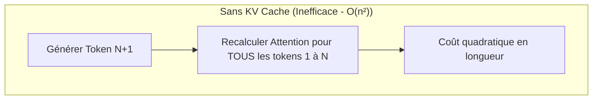
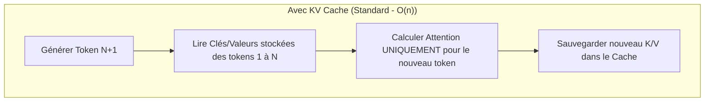
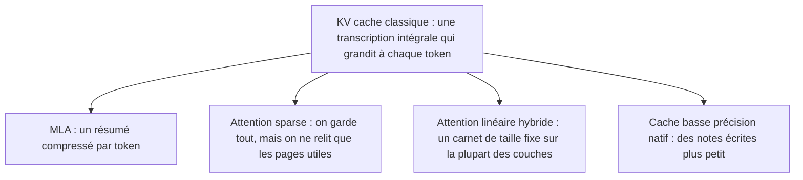

> [!tip] En bref
> Les poids du modèle occupent une VRAM fixe. Mais plus votre conversation est longue, plus le KV Cache grandit et peut consommer autant de VRAM que le modèle lui-même. Ce chapitre explique ce mécanisme et comment le maîtriser.

Si le poids d'un modèle (les paramètres) détermine la quantité de VRAM minimale pour démarrer une IA, la **longueur du contexte** (le prompt + l'historique) dicte la quantité de mémoire dynamique consommée pendant l'utilisation.

À l'usage, un contexte très long (32K, 128K ou plus) peut consommer **plus de [[00-lexique/vram|VRAM]] que le modèle lui-même** [^1]. Ce goulot d'étranglement est géré par un mécanisme physique appelé le **KV Cache** (Key-Value Cache) [^1].

---

## 🧠 Le mécanisme physique : Pourquoi le KV Cache existe-t-il ?

Dans l'architecture Transformer, pour générer le token $N+1$, le modèle doit calculer l'attention (les relations) entre ce nouveau token et **tous les tokens précédents ($1$ à $N$)** [^2].

*   **Sans KV Cache :** Pour chaque mot généré, le modèle devrait ré-exécuter l'intégralité des calculs pour tout l'historique depuis le début. La complexité de calcul serait quadratique ($O(n^2)$), rendant l'IA inutilisable sur des prompts longs [^2].
*   **Avec KV Cache :** Le moteur d'inférence calcule les vecteurs **Key (K)** et **Value (V)** de chaque token une seule fois (lors de la phase de [[00-lexique/prefill|Prefill]]) et les stocke en VRAM [^2]. Pendant la phase de [[00-lexique/decoding|Decoding]], le modèle n'a plus qu'à lire ce cache au lieu de recalculer l'historique [^2].

---

## 📐 L'Équation Mathématique du KV Cache

Pour calculer l'empreinte mémoire exacte (en octets) du KV Cache, on utilise la formule suivante, adaptée à l'architecture moderne **GQA (Grouped-Query Attention)** [^3][^4] :

$$\text{Taille du KV Cache (octets)} = 2 \times L \times H_{kv} \times D \times S \times B \times B_{pe}$$

Où :
*   **$2$** : Représente les deux tenseurs stockés (Key et Value) [^3].
*   **$L$** : Nombre de couches du Transformer (*Layers*) [^3].
*   **$H_{kv}$** : Nombre de têtes d'attention Key-Value (après application du GQA) [^3].
*   **$D$** : Dimension de chaque tête (*Head Dimension*) [^3].
*   **$S$** : Longueur de la séquence (*Sequence Length*, en tokens) [^3].
*   **$B$** : Taille du lot (*Batch Size*, nombre de requêtes simultanées) [^3].
*   **$B_{pe}$** : Taille d'un élément en mémoire (*Bytes Per Element*, ex: $2$ pour FP16/BF16, $1$ pour FP8/INT8 ; NVFP4 vise ~$0{,}5$ octet avec un léger overhead de scaling) [^3][^12].

> [!note] Go vs GiB
> Les tableaux ci-dessous expriment les tailles en **gigaoctets décimaux (Go, $10^9$ octets)**, comme la plupart des fiches techniques du projet. Les OS et les outils (`nvidia-smi`, Activity Monitor) affichent souvent des **gibioctets (GiB, $2^{30}$ octets)** sous l'étiquette « Go » ou « GB ». À 128K tokens BF16, $41{,}94 \text{ Go}$ ≈ **$39{,}06 \text{ GiB}$** — écart d'environ 7 % à intégrer dans votre marge de sécurité VRAM.

### 💡 Focus : L'impact de l'architecture GQA
Dans l'ancienne architecture MHA (Multi-Head Attention), chaque tête de Query avait sa propre tête Key-Value ($H_{kv} = H_{query}$).
Avec **Grouped-Query Attention (GQA)**, plusieurs têtes de Query partagent la même tête Key/Value (sur Llama 3.1 70B : $64$ têtes Query pour $8$ têtes KV, soit un ratio de 8:1) [^5]. Cela **divise par 8 la taille du KV Cache** en mémoire, avec une perte de qualité généralement faible — proche du MHA sur les benchmarks courants, bien qu'elle ne soit pas nulle [^5].

Les architectures hybrides de 2026 (Mamba-2 + MoE + attention dans Nemotron 3.5 Lightning, attention sparse + linéaire dans GLM-5.3-Flash) ne stockent un KV cache que pour une fraction des couches : la formule ci-dessus surestime alors fortement leur empreinte [^16]. Ces nouvelles architectures sont expliquées plus bas, dans la section « Quand le modèle lui-même réduit sa mémoire ».

---

## 📊 Cas Pratiques : Sizing de la VRAM (Llama 3.1 70B)

Prenons le modèle de référence **Llama 3.1 70B** [^4]. Ses caractéristiques physiques sont :
*   Nombre de couches ($L$) = $80$ [^4]
*   Nombre de têtes KV ($H_{kv}$) = $8$ (GQA) [^4]
*   Dimension des têtes ($D$) = $128$ [^4]
*   Précision native ($B_{pe}$) = $2$ octets (BF16) [^4]
*   Fenêtre de contexte native = **128K tokens** [^4]

Calculons la VRAM nécessaire pour **une seule requête ($B=1$)** à différentes fenêtres de contexte :

| Longueur du Contexte ($S$) | Taille du KV Cache (BF16) | Taille avec Quantification (FP8) [^8] | Taille avec NVFP4 (Blackwell) [^12] |
| :--- | :--- | :--- | :--- |
| **8 192 tokens** | $\sim 2,68 \text{ Go}$ | $\sim 1,34 \text{ Go}$ | $\sim 0,67 \text{ Go}$ |
| **32 768 tokens** (32K) | $\sim 10,73 \text{ Go}$ | $\sim 5,36 \text{ Go}$ | $\sim 2,68 \text{ Go}$ |
| **128 000 tokens** (128K, max natif) | $\sim 41,94 \text{ Go}$ | $\sim 20,97 \text{ Go}$ | $\sim 10,48 \text{ Go}$ |
| **300 000 tokens** (extrapolation) | $\sim 98,30 \text{ Go}$ | $\sim 49,15 \text{ Go}$ | $\sim 24,57 \text{ Go}$ |

> [!note] Extrapolation 300K
> La ligne **300K** est une **extrapolation mathématique** (RoPE scaling ou contexte étendu par le moteur), pas la fenêtre native du modèle. Les chiffres BF16 à 128K recoupent les estimations publiées par Meta et Hugging Face (~39–42 Go) [^6].

Les modèles de 2026 rendent la ligne 300K banale : Qwen3.8-27B et Muse Glimmer 30B ont 262k / 131k tokens natifs, Nemotron 3.5 Lightning et DeepSeek V4.1 jusqu'à 1M. DeepSeek-V4.1-Flash livre d'ailleurs son KV cache **en FP4 natif** (E2M1 + une échelle E4M3 par 16 canaux, 890 octets par token, ≈ ¼ de V4-Flash) : la compression du cache devient une propriété du modèle, pas seulement un réglage du moteur [^15]. La section « Quand le modèle lui-même réduit sa mémoire », plus bas, présente les autres approches de ce type.

### Le Piège de l'OOM (Out Of Memory) en contexte long

> [!warning] Piège de l'OOM
> Si vous faites tourner Llama 3.1 70B quantifié en 4-bit (qui pèse $\sim 40 \text{ Go}$ de poids fixes) sur un Mac Studio 64 Go :
>
> *   À **8K de contexte**, le total (Modèle + Cache) fait $\sim 42,7 \text{ Go}$. Tout fonctionne parfaitement.
> *   À **128K de contexte** en BF16, le KV Cache demande $41,9 \text{ Go}$ supplémentaires. Le total requis monte à **$82 \text{ Go}$**. Votre machine de 64 Go s'effondre en erreur *Out Of Memory* ou bascule sur la RAM système lente, détruisant vos performances [^1].

---

## 🛠️ Les Technologies d'Optimisation du Contexte

Pour éviter l'explosion de la VRAM sur site, les ingénieurs système déploient plusieurs optimisations logicielles :

### 1. PagedAttention (vLLM / SGLang)
Dans les moteurs d'inférence classiques, le KV Cache est souvent **pré-alloué de manière contiguë** en VRAM [^7]. Cela crée fragmentation et gaspillage : les implémentations naïves n'utilisent typiquement que **20 à 38 %** de la mémoire GPU réservée au KV cache [^7].
**[[00-lexique/pagedattention|PagedAttention]]** s'inspire de la **mémoire paginée** des systèmes d'exploitation [^7]. Le KV Cache est découpé en blocs fixes, alloués à la demande et mappés via une table de pages. L'utilisation mémoire monte à **~96 %**, et le débit augmente typiquement de **2 à 4×** à latence équivalente (jusqu'à plus selon le workload) [^7]. Dans vLLM, le noyau PagedAttention d'origine a été remplacé mi-2026 par les backends d'attention de la V1, mais le principe — KV cache en blocs alloués à la demande — reste le socle de tous les moteurs de production [^17].

### 2. La Quantification du KV Cache (FP8 / INT8 / NVFP4 / Q4)
De la même manière que l'on compresse les poids d'un modèle, on peut compresser son KV Cache [^1].
*   **FP8 / INT8 :** Supportés nativement par `vLLM` (`kv_cache_dtype="fp8"`) et d'autres moteurs de production [^8]. Cela divise la taille du cache par 2 ; la précision reste proche du BF16 si les scales sont **calibrées** (dataset ou `llm-compressor`), avec des écarts possibles sur certains modèles à attention hybride ou `head_dim` élevé [^8][^13].
*   **Q4 / INT8 sur K et V :** `llama.cpp` expose `--cache-type-k` et `--cache-type-v` (ex. `q8_0` / `q4_0`) [^9]. La compression agressive peut dégrader la perplexité sur des raisonnements longs, surtout si les clés (K) sont trop quantifiées [^9].

### 3. Flash-Decoding (FlashAttention-2/3)
Sur de très longs contextes, la phase de décodage devient limitée par la [[00-lexique/memory-bandwidth|bande passante mémoire]] : avec un batch de 1, FlashAttention classique sous-utilise le GPU [^10].
**Flash-Decoding** (Together AI, 2023) ajoute une dimension de parallélisme sur la **longueur de la séquence Key-Value** : les blocs K/V sont lus et traités en parallèle, puis recombinés [^10]. Cette technique est reprise dans **FlashAttention-3** (split-KV, parallélisation GQA) pour les GPU Hopper et au-delà [^11].

---

## 🧬 Quand le modèle lui-même réduit sa mémoire : les nouvelles architectures

Les techniques précédentes agissent **dans le moteur d'inférence** : elles rangent mieux le cache ou le compressent. Depuis 2024, une autre famille d'optimisations agit **dans le modèle lui-même**, dès sa conception. Les laboratoires chinois (DeepSeek, Moonshot AI avec Kimi, Qwen, MiniMax) y jouent un rôle moteur. L'idée commune : ne plus garder en mémoire, pour chaque token, une copie complète de ses clés (K) et de ses valeurs (V).

Pour fixer les idées, imaginez que le modèle prend des notes pendant une réunion. Le KV cache classique, c'est **une transcription intégrale**, mot pour mot, qui s'allonge sans fin. Les quatre approches ci-dessous changent la manière de prendre ces notes.

### 1. MLA : garder un résumé compressé plutôt que les notes complètes

**Le problème.** Avec l'attention classique ([[00-lexique/attention|MHA]]), chaque couche stocke, pour chaque token, un vecteur K et un vecteur V par tête d'attention. Le GQA vu plus haut réduit déjà ce volume en faisant partager les mêmes K et V à plusieurs têtes.

**L'intuition.** Plutôt que de garder les notes complètes, on garde **un petit résumé** de chaque token. Quand le modèle en a besoin, il « redéplie » ce résumé pour retrouver les K et les V. C'est la **[[00-lexique/mla|Multi-head Latent Attention (MLA)]]**, introduite par DeepSeek-V2 en mai 2024 : le cache stocke un **vecteur latent compressé** (le « résumé ») au lieu des K et V complets [^19].

**Le gain, selon la source.** DeepSeek annonce que DeepSeek-V2 réduit le KV cache de **93,3 %** par rapport à son modèle précédent, DeepSeek 67B [^19]. Le papier précise que le cache de MLA équivaut à celui d'un GQA avec seulement **2,25 groupes**, tout en obtenant de meilleurs résultats que l'attention classique MHA [^19].

**Qui l'utilise.** DeepSeek-V3 (671 milliards de paramètres, dont 37 milliards actifs par token) a conservé MLA [^20]. Kimi K2 de Moonshot AI (1 000 milliards de paramètres, dont 32 milliards actifs) indique aussi « MLA » comme mécanisme d'attention dans sa fiche [^20].

**Un ordre de grandeur.** Le fichier de configuration de Kimi K2 donne 61 couches, un vecteur latent de 512 valeurs et 64 valeurs de position par token et par couche [^20]. Avec la formule de DeepSeek-V2 (taille du vecteur latent + taille de la partie position, multipliée par le nombre de couches) [^19], on obtient en BF16 : $(512 + 64) \times 61 \times 2 \approx 70 \text{ Ko}$ par token, soit **environ 9 Go à 128K tokens**. C'est un calcul théorique : le moteur ajoute ses propres marges. À comparer aux $\sim 41{,}94 \text{ Go}$ de Llama 3.1 70B au même contexte (tableau plus haut), pour un modèle qui compte pourtant 14 fois plus de paramètres.

### 2. L'attention sparse (DSA) : ne relire que les pages utiles

**Le problème.** Même avec un cache compact, le modèle doit **relire tout l'historique** à chaque nouveau token. Sur 128K tokens, cette relecture devient le principal poste de coût.

**L'intuition.** Quand vous cherchez une information dans un long dossier, vous ne relisez pas tout : vous parcourez la table des matières, puis vous ouvrez **seulement les pages utiles**. C'est l'**[[00-lexique/sparse-attention|attention sparse]]** (« clairsemée »). La **DeepSeek Sparse Attention (DSA)**, introduite avec DeepSeek-V3.2-Exp puis reprise dans DeepSeek-V3.2, procède en deux temps [^21] :

1. Un petit module rapide, le **lightning indexer**, donne une note de pertinence à chaque token passé.
2. Le modèle ne fait le calcul d'attention complet que sur les **2 048 tokens** les mieux notés.

**Le gain, selon la source.** DeepSeek indique que DSA fait passer le coût du calcul d'attention principal d'une croissance **quadratique** ($O(L^2)$, où $L$ est la longueur du contexte) à $O(L \cdot k)$, où $k$, le nombre de tokens retenus, est bien plus petit que $L$ [^21]. Sur les benchmarks publics, DeepSeek-V3.2-Exp obtient des résultats au niveau de son prédécesseur, DeepSeek-V3.1-Terminus [^21].

> [!warning] DSA économise du calcul, pas de la place
> DSA est construit sur MLA : chaque token garde son résumé compressé dans le cache [^21]. Le cache ne rétrécit donc pas par rapport à MLA. Ce qui baisse, c'est la quantité de cache **relue** à chaque token, donc le temps et le coût du contexte long.

### 3. L'attention linéaire hybride : un carnet de taille fixe

**Le problème.** Avec l'attention classique, chaque nouveau token ajoute une ligne au cache. La mémoire grandit **en proportion du contexte** : c'est ce que montrent les tableaux plus haut.

**L'intuition.** Au lieu d'une transcription qui s'allonge, imaginez **un carnet de taille fixe**. À chaque token, le modèle efface un peu, corrige ce qui doit l'être et ajoute l'essentiel. Le carnet ne grossit jamais, que la conversation fasse 1 000 ou 1 million de tokens. C'est l'**[[00-lexique/linear-attention|attention linéaire]]**. Les travaux de 2024-2025 ont rendu ce carnet plus fiable : un mécanisme d'oubli (le *gating*) permet d'effacer vite, et la « règle delta » permet de corriger une note précise [^22].

Un carnet de taille fixe retient moins bien les détails qu'une transcription complète. Les modèles récents gardent donc **quelques couches d'attention classique** (avec un vrai KV cache) au milieu des couches linéaires. On parle d'**architecture hybride** :

*   **Qwen3-Next** (Qwen, 80 milliards de paramètres dont 3 milliards actifs) : la combinaison *Gated DeltaNet* (linéaire) + *Gated Attention* (classique) remplace l'attention standard, avec 3 couches linéaires pour 1 couche classique [^23]. Pour la version de base, Qwen annonce un débit d'inférence **10 fois supérieur** à Qwen3-32B au-delà de 32K tokens de contexte [^23]. Le même schéma (3 pour 1) se retrouve dans **Qwen3.8-27B**, cité plus haut [^23].
*   **Kimi Linear** (Moonshot AI, 48 milliards de paramètres dont 3 milliards actifs) : sa *Kimi Delta Attention* (KDA) garde un état de taille fixe ; une couche MLA classique revient toutes les trois couches KDA [^24]. Résultat annoncé : jusqu'à **75 % de KV cache en moins** et jusqu'à **6 fois plus de débit** en génération à 1 million de tokens, par rapport à un modèle tout en MLA, avec de meilleurs résultats sur toutes les tâches évaluées [^24]. Kimi K3 (juillet 2026) reprend la recette : 69 couches KDA et 24 couches « Gated MLA » [^24].
*   **MiniMax-M1** (MiniMax, 456 milliards de paramètres dont 45,9 milliards actifs, contexte natif de 1 million de tokens) : sa *Lightning Attention* est une variante d'attention linéaire, avec une couche d'attention classique toutes les sept couches [^25]. MiniMax annonce **environ 25 % des opérations de calcul** (FLOPs) de DeepSeek R1 pour générer 100K tokens [^25]. Ce chiffre porte sur le calcul : le papier ne chiffre pas la mémoire.

Le GLM-5.3-Flash de Z.ai, mentionné plus haut, combine lui aussi attention sparse et attention linéaire, sans que sa fiche ne détaille la proportion des couches [^16].

### 4. Le cache basse précision intégré au modèle

Dernière approche : **écrire les notes plus petit**. C'est la quantification du KV cache vue plus haut, mais choisie par le concepteur du modèle et prise en compte dès l'entraînement, au lieu d'être réglée après coup dans le moteur. DeepSeek-V4.1-Flash en est l'exemple, avec son cache **FP4 natif** de 890 octets par token, présenté dans les cas pratiques plus haut [^15]. Ces approches se cumulent : la fiche de V4.1-Flash décrit aussi une attention sparse compressée (*Compressed Sparse Attention 2*) [^15].

### 📊 Tableau récapitulatif

| Technique | L'idée en une ligne | Ce qui est stocké par token | Modèles ouverts (exemples) | Gain annoncé par la source |
| :--- | :--- | :--- | :--- | :--- |
| **MLA** | Un résumé compressé au lieu des notes complètes | Un vecteur latent (+ une petite partie position) par couche | DeepSeek-V2, V3, V3.2 ; Kimi K2 | −93,3 % de KV cache vs DeepSeek 67B [^19] |
| **DSA** (attention sparse) | Ne relire que les 2 048 tokens les plus pertinents | Comme MLA (le cache ne rétrécit pas) | DeepSeek-V3.2-Exp, V3.2 | Calcul d'attention $O(L^2) \to O(L \cdot k)$ [^21] |
| **Attention linéaire hybride** | Un carnet de taille fixe sur la plupart des couches | Un état fixe sur les couches linéaires, un KV cache sur les autres | Qwen3-Next, Qwen3.8-27B, Kimi Linear, Kimi K3, MiniMax-M1 | Kimi Linear : jusqu'à −75 % de KV cache vs tout-MLA [^24] ; MiniMax-M1 : ~25 % des FLOPs de DeepSeek R1 à 100K tokens [^25] |
| **Cache basse précision natif** | Des notes écrites plus petit | K/V en FP4 | DeepSeek-V4.1-Flash | 890 octets/token, ≈ ¼ de V4-Flash [^15] |

### Support dans les moteurs d'inférence

Au 11 octobre 2026, la liste officielle des modèles de vLLM inclut les architectures DeepSeek-V2, DeepSeek-V3 (que Kimi K2 réutilise [^20]), DeepSeek-V3.2, Qwen3-Next et Kimi Linear [^26]. Côté llama.cpp, le support de Kimi Linear a été fusionné en février 2026, Qwen3-Next y tourne en GGUF, et un opérateur dédié au lightning indexer de DeepSeek V3.2 a été ajouté en juillet 2026 [^26]. La fiche de Qwen3-Next demande au moins SGLang 0.5.2 ou vLLM 0.10.2 [^23]. Nous n'avons pas trouvé MiniMax-M1 dans la liste actuelle de vLLM : vérifiez son support avant de planifier un déploiement.

> [!tip] Conséquence pour le dimensionnement
> La formule GQA de ce chapitre **surestime fortement** le KV cache de ces modèles. Elle suppose que chaque couche stocke des K et des V complets pour chaque token, ce qui n'est vrai ni pour MLA (un résumé compressé), ni pour les couches linéaires (un état de taille fixe). Pour dimensionner votre VRAM, partez de la taille de cache indiquée dans la **fiche du modèle**, ou de la capacité de cache que votre **moteur d'inférence** affiche au démarrage. Appliquer la formule GQA à ces modèles revient à acheter plus de VRAM que nécessaire.

---

## 📋 Le Conseil de l'Architecte

Pour tout déploiement d'assistant on-premise, la gestion du KV cache dicte votre stratégie matérielle :

1.  **Injectez le contexte, ne noyez pas le modèle :** Plutôt que de charger des fichiers entiers de 150 000 mots dans la fenêtre du LLM (ce qui saturerait votre VRAM dynamique), récupérez seulement les passages pertinents — via un index hiérarchique de mémoire (chunks Markdown + résumés, à la manière du Memory Tree local qu'OpenHuman proposait jusqu'au T2 2026 avant de passer à une mémoire hébergée)[^14], un RAG vectoriel, ou les deux combinés.
2.  **Activez le FP8 KV Cache — ou NVFP4 sur Blackwell :** sur vLLM (`--kv-cache-dtype fp8`, ou `nvfp4` sur GPU Blackwell) ou LMDeploy, divisez par deux (FP8) ou par quatre (NVFP4) votre consommation dynamique de VRAM, en calibrant les scales si possible [^8][^12][^18].
3.  **Surveillez le ratio Batch/Contexte :** Sur un serveur partagé par plusieurs collaborateurs en simultané, le KV Cache se multiplie par le nombre d'utilisateurs actifs ($B$) — dimensionner la VRAM en conséquence.

---

## 📚 Sources et Références

[^1]: NVIDIA Technical Blog, *Mastering LLM Techniques: Inference Optimization*, novembre 2023. [https://developer.nvidia.com/blog/mastering-llm-techniques-inference-optimization/](https://developer.nvidia.com/blog/mastering-llm-techniques-inference-optimization/)
[^2]: NVIDIA Technical Blog, *Mastering LLM Techniques: Inference Optimization* (prefill, decode, mécanisme KV cache), novembre 2023. [https://developer.nvidia.com/blog/mastering-llm-techniques-inference-optimization/](https://developer.nvidia.com/blog/mastering-llm-techniques-inference-optimization/)
[^3]: VMware Cloud Foundation Blog, *LLM Inference Sizing and Performance Guidance* (formule KV cache GQA), septembre 2024. [https://blogs.vmware.com/cloud-foundation/2024/09/25/llm-inference-sizing-and-performance-guidance/](https://blogs.vmware.com/cloud-foundation/2024/09/25/llm-inference-sizing-and-performance-guidance/)
[^4]: Meta, *Llama 3.1 Model Card* (architecture, GQA, contexte 128K), juillet 2024. [https://github.com/meta-llama/llama-models/blob/main/models/llama3_1/MODEL_CARD.md](https://github.com/meta-llama/llama-models/blob/main/models/llama3_1/MODEL_CARD.md)
[^5]: Joshua Ainslie et al., *GQA: Training Generalized Multi-Query Transformer Models from Multi-Head Checkpoints* (arXiv:2305.13245), 2023. [https://arxiv.org/html/2305.13245](https://arxiv.org/html/2305.13245)
[^6]: Hugging Face Blog, *Llama 3.1* (tableau empreinte KV cache FP16 par taille de modèle), juillet 2024. [https://github.com/huggingface/blog/blob/main/llama31.md](https://github.com/huggingface/blog/blob/main/llama31.md)
[^7]: W. Kwon et al., *Efficient Memory Management for Large Language Model Serving with PagedAttention* (SOSP 2023, arXiv:2309.06180). [https://arxiv.org/abs/2309.06180](https://arxiv.org/abs/2309.06180)
[^8]: vLLM Documentation, *Quantized KV Cache* (FP8, calibration), 2026. [https://docs.vllm.ai/en/latest/features/quantization/quantized_kvcache/](https://docs.vllm.ai/en/latest/features/quantization/quantized_kvcache/)
[^9]: llama.cpp, *Server README* (`--cache-type-k`, `--cache-type-v`), 2026. [https://github.com/ggml-org/llama.cpp/blob/master/tools/server/README.md](https://github.com/ggml-org/llama.cpp/blob/master/tools/server/README.md)
[^10]: Together AI, *Flash-Decoding for long-context inference*, octobre 2023. [https://www.together.ai/blog/flash-decoding-for-long-context-inference](https://www.together.ai/blog/flash-decoding-for-long-context-inference)
[^11]: Dao-AILab, *FA3 kvcache + split kv + gqa parallelization* (PR #1236), septembre 2024. [https://github.com/Dao-AILab/flash-attention/pull/1236](https://github.com/Dao-AILab/flash-attention/pull/1236)
[^12]: NVIDIA Technical Blog, *Optimizing Inference for Long Context and Large Batch Sizes with NVFP4 KV Cache*, décembre 2025. [https://developer.nvidia.com/blog/optimizing-inference-for-long-context-and-large-batch-sizes-with-nvfp4-kv-cache/](https://developer.nvidia.com/blog/optimizing-inference-for-long-context-and-large-batch-sizes-with-nvfp4-kv-cache/)
[^13]: vLLM Blog, *The State of FP8 KV-Cache and Attention Quantization in vLLM*, avril 2026. [https://vllm.ai/blog/2026-04-22-fp8-kvcache](https://vllm.ai/blog/2026-04-22-fp8-kvcache)
[^14]: OpenHuman, *Memory* (GitBook — la mémoire est désormais servie par CortexDB, hébergé ou auto-hébergé ; l'ancien Memory Tree local SQLite + Markdown a été retiré), relu le 2026-10-09. [https://tinyhumans.gitbook.io/openhuman/features/memory](https://tinyhumans.gitbook.io/openhuman/features/memory)
[^15]: DeepSeek AI, *DeepSeek-V4.1-Flash* (« FP4 main KV caching », E2M1 + une échelle E4M3 par 16 canaux, 890 octets par token ≈ ¼ de V4-Flash, MIT), 2026. [https://huggingface.co/deepseek-ai/DeepSeek-V4.1-Flash](https://huggingface.co/deepseek-ai/DeepSeek-V4.1-Flash) ; Qwen, *Qwen3.8-27B* (contexte 262k), août 2026. [https://huggingface.co/Qwen/Qwen3.8-27B](https://huggingface.co/Qwen/Qwen3.8-27B) ; Meta, *Muse Glimmer 30B* (131 072+ tokens), août 2026. [https://huggingface.co/meta-models/Muse-Glimmer-30B](https://huggingface.co/meta-models/Muse-Glimmer-30B)
[^16]: NVIDIA, *NVIDIA-Nemotron-3.5-Lightning-30B-A3B-BF16* (« Mamba-2 + MoE + Attention hybrid », jusqu'à 1M tokens), août 2026. [https://huggingface.co/nvidia/NVIDIA-Nemotron-3.5-Lightning-30B-A3B-BF16](https://huggingface.co/nvidia/NVIDIA-Nemotron-3.5-Lightning-30B-A3B-BF16) ; Z.ai, *GLM-5.3-Flash* (« hybrid architecture combining sparse and linear attention »), 2026. [https://huggingface.co/zai-org/GLM-5.3-Flash](https://huggingface.co/zai-org/GLM-5.3-Flash)
[^17]: vLLM Project, *Release v0.25.0* (retrait de l'implémentation PagedAttention historique au profit des backends d'attention V1 / Model Runner V2), 11 juillet 2026. [https://github.com/vllm-project/vllm/releases/tag/v0.25.0](https://github.com/vllm-project/vllm/releases/tag/v0.25.0)
[^18]: vLLM, *Cache configuration* (`kv_cache_dtype` : `auto`, `fp8`, `fp8_e4m3`, `fp8_e5m2`, `nvfp4`), consulté le 2026-10-10. [https://docs.vllm.ai/en/stable/api/vllm/config/cache/](https://docs.vllm.ai/en/stable/api/vllm/config/cache/) · vLLM Project, *Release v0.31.0* (KV cache NVFP4 par défaut sur SM100 pour DeepSeek-V4.1-Flash), 5 octobre 2026. [https://github.com/vllm-project/vllm/releases/tag/v0.31.0](https://github.com/vllm-project/vllm/releases/tag/v0.31.0)
[^19]: DeepSeek-AI, *DeepSeek-V2: A Strong, Economical, and Efficient Mixture-of-Experts Language Model* (arXiv:2405.04434 ; MLA compresse le KV cache en un vecteur latent, −93,3 % de KV cache par rapport à DeepSeek 67B, cache équivalent à un GQA à 2,25 groupes, meilleur que MHA ; cache par token = (d_c + d_h^R) × l éléments), mai 2024. [https://arxiv.org/abs/2405.04434](https://arxiv.org/abs/2405.04434)
[^20]: DeepSeek-AI, *DeepSeek-V3 Technical Report* (arXiv:2412.19437 ; MLA et DeepSeekMoE, 671 B de paramètres dont 37 B activés par token), décembre 2024. [https://arxiv.org/abs/2412.19437](https://arxiv.org/abs/2412.19437) ; Moonshot AI, *Kimi-K2-Instruct* (mécanisme d'attention « MLA », 1T de paramètres, 32B activés, licence Modified MIT ; `config.json` : `DeepseekV3ForCausalLM`, 61 couches, `kv_lora_rank` 512, `qk_rope_head_dim` 64), juillet 2025. [https://huggingface.co/moonshotai/Kimi-K2-Instruct](https://huggingface.co/moonshotai/Kimi-K2-Instruct)
[^21]: DeepSeek-AI, *DeepSeek-V3.2: Pushing the Frontier of Open Large Language Models* (arXiv:2512.02556, section 2.1 : lightning indexer, sélection de 2 048 tokens clé-valeur par token, attention principale O(L²) → O(Lk), DSA implémentée sur le mode MQA de MLA), décembre 2025. [https://arxiv.org/abs/2512.02556](https://arxiv.org/abs/2512.02556) ; DeepSeek AI, *DeepSeek-V3.2-Exp* (performances « on par with V3.1-Terminus », licence MIT), 2025. [https://huggingface.co/deepseek-ai/DeepSeek-V3.2-Exp](https://huggingface.co/deepseek-ai/DeepSeek-V3.2-Exp)
[^22]: S. Yang, J. Kautz, A. Hatamizadeh, *Gated Delta Networks: Improving Mamba2 with Delta Rule* (arXiv:2412.06464 ; le gating permet un effacement rapide de la mémoire, la règle delta des mises à jour ciblées), décembre 2024 (ICLR 2025). [https://arxiv.org/abs/2412.06464](https://arxiv.org/abs/2412.06464)
[^23]: Qwen, *Qwen3-Next-80B-A3B-Instruct* (Gated DeltaNet + Gated Attention, disposition 12 × (3 × Gated DeltaNet → 1 × Gated Attention), 80B / 3B activés, 262 144 tokens natifs, Apache 2.0 ; version de base : débit d'inférence ×10 vs Qwen3-32B au-delà de 32K tokens ; `sglang>=0.5.2`, `vllm>=0.10.2`), 2025. [https://huggingface.co/Qwen/Qwen3-Next-80B-A3B-Instruct](https://huggingface.co/Qwen/Qwen3-Next-80B-A3B-Instruct) ; Qwen, *Qwen3.8-27B* (disposition 16 × (3 × Gated DeltaNet → 1 × Gated Attention), 64 couches), août 2026. [https://huggingface.co/Qwen/Qwen3.8-27B](https://huggingface.co/Qwen/Qwen3.8-27B)
[^24]: Kimi Team, *Kimi Linear: An Expressive, Efficient Attention Architecture* (arXiv:2510.26692 ; KDA à état de taille fixe, hybride KDA / MLA en ratio 3:1, 48B / 3B activés, jusqu'à −75 % de KV cache et ×6 de débit de décodage à 1M de contexte vs full MLA), octobre 2025. [https://arxiv.org/abs/2510.26692](https://arxiv.org/abs/2510.26692) ; Moonshot AI, *Kimi K3* (« KDA & Gated MLA », 69 KDA + 24 Gated MLA), juillet 2026. [https://huggingface.co/moonshotai/Kimi-K3](https://huggingface.co/moonshotai/Kimi-K3)
[^25]: MiniMax, *MiniMax-M1: Scaling Test-Time Compute Efficiently with Lightning Attention* (arXiv:2506.13585 ; Lightning Attention = « I/O-aware implementation of a linear attention variant », un bloc softmax après sept blocs linéaires, 456B / 45,9B activés, 1M de contexte natif, ~25 % des FLOPs de DeepSeek R1 à 100K tokens générés), juin 2025. [https://arxiv.org/abs/2506.13585](https://arxiv.org/abs/2506.13585)
[^26]: vLLM Documentation, *Supported Models* (`DeepseekV2ForCausalLM`, `DeepseekV3ForCausalLM`, `DeepseekV32ForCausalLM`, `Qwen3NextForCausalLM`, `KimiLinearForCausalLM`), consulté le 2026-10-11. [https://docs.vllm.ai/en/latest/models/supported_models.html](https://docs.vllm.ai/en/latest/models/supported_models.html) · llama.cpp, *Kimi-Linear support* (PR #18755, fusionnée le 2026-02-06). [https://github.com/ggml-org/llama.cpp/pull/18755](https://github.com/ggml-org/llama.cpp/pull/18755) · llama.cpp, *models : optimizing qwen3next graph* (PR #19375, fusionnée le 2026-02-14, benchmark Qwen3-Next 80B-A3B en Q4_0). [https://github.com/ggml-org/llama.cpp/pull/19375](https://github.com/ggml-org/llama.cpp/pull/19375) · llama.cpp, *New GGML_OP_LIGHTNING_INDEXER that implements DeepSeek V3.2/V4 lightning indexer* (PR #24231, fusionnée le 2026-07-11). [https://github.com/ggml-org/llama.cpp/pull/24231](https://github.com/ggml-org/llama.cpp/pull/24231)
