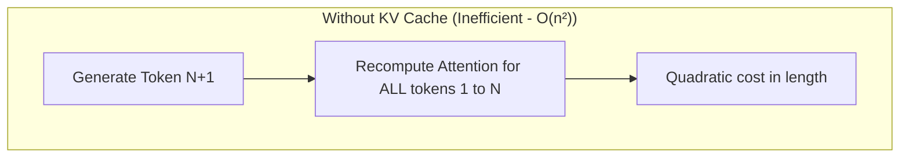
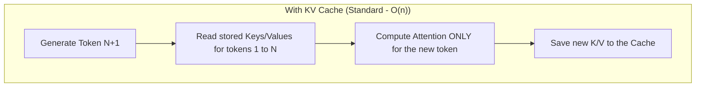
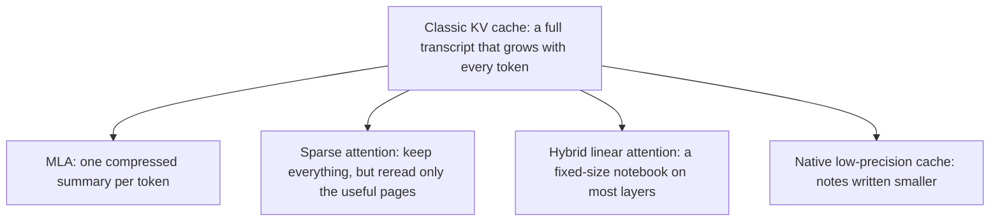

> [!tip] In brief
> Model weights occupy fixed VRAM. But the longer your conversation, the larger the KV Cache grows—and it can consume as much VRAM as the model itself. This chapter explains that mechanism and how to control it.

If a model's weights (its parameters) determine the minimum VRAM needed to start an AI, **context length** (the prompt + history) dictates how much dynamic memory is consumed during use.

In practice, a very long context (32K, 128K, or more) can consume **more [[00-lexique/vram|VRAM]] than the model itself** [^1]. That bottleneck is managed by a physical mechanism called the **KV Cache** (Key-Value Cache) [^1].

---

## 🧠 The physical mechanism: Why the KV Cache exists

In the Transformer architecture, to generate token $N+1$, the model must compute attention (relationships) between that new token and **all previous tokens ($1$ to $N$)** [^2].

*   **Without KV Cache:** For each generated word, the model would have to re-run all computations for the entire history from the start. Computational complexity would be quadratic ($O(n^2)$), making the AI unusable on long prompts [^2].
*   **With KV Cache:** The inference engine computes the **Key (K)** and **Value (V)** vectors for each token once (during the [[00-lexique/prefill|Prefill]] phase) and stores them in VRAM [^2]. During [[00-lexique/decoding|Decoding]], the model only reads this cache instead of recomputing history [^2].

---

## 📐 The mathematical equation of the KV Cache

To compute the exact memory footprint (in bytes) of the KV Cache, use the following formula, adapted to the modern **GQA (Grouped-Query Attention)** architecture [^3][^4]:

$$\text{KV Cache size (bytes)} = 2 \times L \times H_{kv} \times D \times S \times B \times B_{pe}$$

Where:
*   **$2$** : Represents the two stored tensors (Key and Value) [^3].
*   **$L$** : Number of Transformer layers (*Layers*) [^3].
*   **$H_{kv}$** : Number of Key-Value attention heads (after GQA) [^3].
*   **$D$** : Dimension of each head (*Head Dimension*) [^3].
*   **$S$** : Sequence length (*Sequence Length*, in tokens) [^3].
*   **$B$** : Batch size (*Batch Size*, number of concurrent requests) [^3].
*   **$B_{pe}$** : Size of one element in memory (*Bytes Per Element*, e.g. $2$ for FP16/BF16, $1$ for FP8/INT8; NVFP4 targets ~$0{,}5$ bytes with slight scaling overhead) [^3][^12].

> [!note] GB vs GiB
> The tables below express sizes in **decimal gigabytes (GB, $10^9$ bytes)**, as most technical sheets in this project do. Operating systems and tools (`nvidia-smi`, Activity Monitor) often display **gibibytes (GiB, $2^{30}$ bytes)** under the label "GB" or "Go". At 128K tokens BF16, $41{,}94 \text{ GB}$ ≈ **$39{,}06 \text{ GiB}$** — a gap of about 7% to factor into your VRAM safety margin.

### 💡 Focus: The impact of GQA architecture
In the older MHA (Multi-Head Attention) architecture, each Query head had its own Key-Value head ($H_{kv} = H_{query}$).
With **Grouped-Query Attention (GQA)**, several Query heads share the same Key/Value head (on Llama 3.1 70B: $64$ Query heads for $8$ KV heads, an 8:1 ratio) [^5]. This **divides KV Cache size by 8 in memory**, with generally small quality loss—close to MHA on common benchmarks, though not zero [^5].

The 2026 hybrid architectures (Mamba-2 + MoE + attention in Nemotron 3.5 Lightning, sparse + linear attention in GLM-5.3-Flash) store a KV cache for only a fraction of their layers: the formula above then greatly overestimates their footprint [^16]. These new architectures are explained further down, in the section "When the model itself shrinks its memory".

---

## 📊 Practical cases: VRAM sizing (Llama 3.1 70B)

Take the reference model **Llama 3.1 70B** [^4]. Its physical characteristics are:
*   Number of layers ($L$) = $80$ [^4]
*   Number of KV heads ($H_{kv}$) = $8$ (GQA) [^4]
*   Head dimension ($D$) = $128$ [^4]
*   Native precision ($B_{pe}$) = $2$ bytes (BF16) [^4]
*   Native context window = **128K tokens** [^4]

Let's calculate the VRAM required for **a single request ($B=1$)** at different context windows:

| Context length ($S$) | KV Cache size (BF16) | Size with quantization (FP8) [^8] | Size with NVFP4 (Blackwell) [^12] |
| :--- | :--- | :--- | :--- |
| **8,192 tokens** | $\sim 2.68 \text{ GB}$ | $\sim 1.34 \text{ GB}$ | $\sim 0.67 \text{ GB}$ |
| **32,768 tokens** (32K) | $\sim 10.73 \text{ GB}$ | $\sim 5.36 \text{ GB}$ | $\sim 2.68 \text{ GB}$ |
| **128,000 tokens** (128K, native max) | $\sim 41.94 \text{ GB}$ | $\sim 20.97 \text{ GB}$ | $\sim 10.48 \text{ GB}$ |
| **300,000 tokens** (extrapolation) | $\sim 98.30 \text{ GB}$ | $\sim 49.15 \text{ GB}$ | $\sim 24.57 \text{ GB}$ |

> [!note] 300K extrapolation
> The **300K** row is a **mathematical extrapolation** (RoPE scaling or context extended by the engine), not the model's native window. BF16 figures at 128K align with public estimates from Meta and Hugging Face (~39–42 GB) [^6].

The 2026 models make the 300K row commonplace: Qwen3.8-27B and Muse Glimmer 30B have 262k / 131k native tokens, Nemotron 3.5 Lightning and DeepSeek V4.1 up to 1M. DeepSeek-V4.1-Flash even ships its KV cache **in native FP4** (E2M1 + one E4M3 scale per 16 channels, 890 bytes per token, ≈ ¼ of V4-Flash): cache compression becomes a property of the model, not just an engine setting [^15]. The section "When the model itself shrinks its memory", further down, presents the other approaches of this kind.

### The long-context OOM (Out Of Memory) trap

> [!warning] OOM trap
> If you run Llama 3.1 70B quantized to 4-bit (which weighs $\sim 40 \text{ GB}$ in fixed weights) on a 64 GB Mac Studio:
>
> *   At **8K context**, the total (Model + Cache) is $\sim 42.7 \text{ GB}$. Everything runs fine.
> *   At **128K context** in BF16, the KV Cache needs an additional $41.9 \text{ GB}$. Total required climbs to **$82 \text{ GB}$**. Your 64 GB machine hits *Out Of Memory* or falls back to slow system RAM, destroying performance [^1].

---

## 🛠️ Context optimization technologies

To avoid VRAM explosion on-premises, systems engineers deploy several software optimizations:

### 1. PagedAttention (vLLM / SGLang)
In classic inference engines, the KV Cache is often **pre-allocated contiguously** in VRAM [^7]. That creates fragmentation and waste: naive implementations typically use only **20 to 38%** of GPU memory reserved for the KV cache [^7].
**[[00-lexique/pagedattention|PagedAttention]]** draws on operating-system **paged memory** [^7]. The KV Cache is split into fixed blocks, allocated on demand and mapped via a page table. Memory utilization rises to **~96%**, and throughput typically increases by **2 to 4×** at equivalent latency (more depending on workload) [^7]. In vLLM, the original PagedAttention kernel was replaced in mid-2026 by the V1 attention backends, but the principle — a KV cache in blocks allocated on demand — remains the foundation of every production engine [^17].

### 2. KV Cache quantization (FP8 / INT8 / NVFP4 / Q4)
Just as model weights can be compressed, the KV Cache can be compressed too [^1].
*   **FP8 / INT8 :** Natively supported by `vLLM` (`kv_cache_dtype="fp8"`) and other production engines [^8]. This halves cache size; precision stays close to BF16 if scales are **calibrated** (dataset or `llm-compressor`), with possible gaps on some hybrid-attention models or high `head_dim` [^8][^13].
*   **Q4 / INT8 on K and V :** `llama.cpp` exposes `--cache-type-k` and `--cache-type-v` (e.g. `q8_0` / `q4_0`) [^9]. Aggressive compression can degrade perplexity on long reasoning, especially if keys (K) are over-quantized [^9].

### 3. Flash-Decoding (FlashAttention-2/3)
On very long contexts, the decoding phase becomes limited by [[00-lexique/memory-bandwidth|memory bandwidth]]: with a batch of 1, classic FlashAttention under-utilizes the GPU [^10].
**Flash-Decoding** (Together AI, 2023) adds a parallelism dimension over **Key-Value sequence length**: K/V blocks are read and processed in parallel, then recombined [^10]. This technique is carried into **FlashAttention-3** (split-KV, GQA parallelization) for Hopper GPUs and beyond [^11].

---

## 🧬 When the model itself shrinks its memory: the new architectures

The techniques above work **inside the inference engine**: they store the cache more efficiently or compress it. Since 2024, another family of optimizations works **inside the model itself**, from its design. Chinese labs (DeepSeek, Moonshot AI with Kimi, Qwen, MiniMax) play a leading role here. The common idea: stop keeping, for every token, a full copy of its keys (K) and values (V) in memory.

To make it concrete, imagine the model takes notes during a meeting. The classic KV cache is **a full transcript**, word for word, that keeps growing. The four approaches below change the way these notes are taken.

### 1. MLA: keep a compressed summary instead of the full notes

**The problem.** With classic attention ([[00-lexique/attention|MHA]]), each layer stores, for each token, one K vector and one V vector per attention head. The GQA covered above already reduces this volume by having several heads share the same K and V.

**The intuition.** Instead of keeping the full notes, keep **a short summary** of each token. When the model needs it, it "unfolds" this summary to recover the K and V. This is **[[00-lexique/mla|Multi-head Latent Attention (MLA)]]**, introduced by DeepSeek-V2 in May 2024: the cache stores a **compressed latent vector** (the "summary") instead of the full K and V [^19].

**The gain, according to the source.** DeepSeek states that DeepSeek-V2 reduces the KV cache by **93.3%** compared with its previous model, DeepSeek 67B [^19]. The paper specifies that the MLA cache is equivalent to that of a GQA with only **2.25 groups**, while performing better than classic MHA attention [^19].

**Who uses it.** DeepSeek-V3 (671 billion parameters, 37 billion active per token) kept MLA [^20]. Moonshot AI's Kimi K2 (1,000 billion parameters, 32 billion active) also lists "MLA" as its attention mechanism in its model card [^20].

**An order of magnitude.** Kimi K2's configuration file gives 61 layers, a latent vector of 512 values and 64 position values per token and per layer [^20]. With the DeepSeek-V2 formula (latent vector size + position part size, multiplied by the number of layers) [^19], this gives in BF16: $(512 + 64) \times 61 \times 2 \approx 70 \text{ KB}$ per token, i.e. **about 9 GB at 128K tokens**. This is a theoretical calculation: the engine adds its own margins. Compare with the $\sim 41.94 \text{ GB}$ of Llama 3.1 70B at the same context (table above), for a model that nonetheless has 14 times more parameters.

### 2. Sparse attention (DSA): reread only the useful pages

**The problem.** Even with a compact cache, the model must **reread the whole history** for every new token. At 128K tokens, this rereading becomes the main cost item.

**The intuition.** When you look for a piece of information in a long file, you do not reread everything: you skim the table of contents, then open **only the useful pages**. This is **[[00-lexique/sparse-attention|sparse attention]]**. **DeepSeek Sparse Attention (DSA)**, introduced with DeepSeek-V3.2-Exp and carried over into DeepSeek-V3.2, works in two steps [^21]:

1. A small, fast module, the **lightning indexer**, gives a relevance score to each past token.
2. The model runs the full attention computation only on the **2,048 tokens** with the best scores.

**The gain, according to the source.** DeepSeek states that DSA brings the cost of the core attention computation from **quadratic** growth ($O(L^2)$, where $L$ is the context length) down to $O(L \cdot k)$, where $k$, the number of selected tokens, is much smaller than $L$ [^21]. On public benchmarks, DeepSeek-V3.2-Exp performs on par with its predecessor, DeepSeek-V3.1-Terminus [^21].

> [!warning] DSA saves compute, not space
> DSA is built on MLA: every token keeps its compressed summary in the cache [^21]. The cache therefore does not shrink compared with MLA. What goes down is the amount of cache **reread** for each token, hence the time and cost of long contexts.

### 3. Hybrid linear attention: a fixed-size notebook

**The problem.** With classic attention, each new token adds a line to the cache. Memory grows **in proportion to the context**: this is what the tables above show.

**The intuition.** Instead of a transcript that keeps growing, imagine **a fixed-size notebook**. At each token, the model erases a little, corrects what needs correcting and adds the essentials. The notebook never grows, whether the conversation is 1,000 or 1 million tokens long. This is **[[00-lexique/linear-attention|linear attention]]**. Work from 2024-2025 made this notebook more reliable: a forgetting mechanism (*gating*) allows fast erasure, and the "delta rule" allows a specific note to be corrected [^22].

A fixed-size notebook retains details less well than a full transcript. Recent models therefore keep **a few classic attention layers** (with a real KV cache) among the linear layers. This is called a **hybrid architecture**:

*   **Qwen3-Next** (Qwen, 80 billion parameters, 3 billion active): the combination of *Gated DeltaNet* (linear) + *Gated Attention* (classic) replaces standard attention, with 3 linear layers for 1 classic layer [^23]. For the base version, Qwen announces **10 times higher** inference throughput than Qwen3-32B beyond 32K tokens of context [^23]. The same pattern (3 for 1) is found in **Qwen3.8-27B**, mentioned above [^23].
*   **Kimi Linear** (Moonshot AI, 48 billion parameters, 3 billion active): its *Kimi Delta Attention* (KDA) keeps a fixed-size state; a classic MLA layer comes back every three KDA layers [^24]. Announced result: up to **75% less KV cache** and up to **6 times more throughput** in generation at 1 million tokens, compared with a full-MLA model, with better results on all evaluated tasks [^24]. Kimi K3 (July 2026) reuses the recipe: 69 KDA layers and 24 "Gated MLA" layers [^24].
*   **MiniMax-M1** (MiniMax, 456 billion parameters, 45.9 billion active, native context of 1 million tokens): its *Lightning Attention* is a variant of linear attention, with one classic attention layer every seven layers [^25]. MiniMax announces **about 25% of the compute operations** (FLOPs) of DeepSeek R1 to generate 100K tokens [^25]. This figure is about compute: the paper does not quantify memory.

Z.ai's GLM-5.3-Flash, mentioned above, also combines sparse and linear attention, without its model card detailing the proportion of layers [^16].

### 4. Low-precision cache built into the model

Last approach: **write the notes smaller**. This is the KV cache quantization covered above, but chosen by the model designer and taken into account from training, instead of being tuned after the fact in the engine. DeepSeek-V4.1-Flash is the example, with its **native FP4** cache of 890 bytes per token, presented in the practical cases above [^15]. These approaches stack: the V4.1-Flash model card also describes a compressed sparse attention (*Compressed Sparse Attention 2*) [^15].

### 📊 Summary table

| Technique | The idea in one line | What is stored per token | Open models (examples) | Gain stated by the source |
| :--- | :--- | :--- | :--- | :--- |
| **MLA** | A compressed summary instead of the full notes | One latent vector (+ a small position part) per layer | DeepSeek-V2, V3, V3.2; Kimi K2 | −93.3% KV cache vs DeepSeek 67B [^19] |
| **DSA** (sparse attention) | Reread only the 2,048 most relevant tokens | Same as MLA (the cache does not shrink) | DeepSeek-V3.2-Exp, V3.2 | Attention compute $O(L^2) \to O(L \cdot k)$ [^21] |
| **Hybrid linear attention** | A fixed-size notebook on most layers | A fixed state on linear layers, a KV cache on the others | Qwen3-Next, Qwen3.8-27B, Kimi Linear, Kimi K3, MiniMax-M1 | Kimi Linear: up to −75% KV cache vs full MLA [^24]; MiniMax-M1: ~25% of DeepSeek R1's FLOPs at 100K tokens [^25] |
| **Native low-precision cache** | Notes written smaller | K/V in FP4 | DeepSeek-V4.1-Flash | 890 bytes/token, ≈ ¼ of V4-Flash [^15] |

### Support in inference engines

As of 11 October 2026, vLLM's official model list includes the DeepSeek-V2, DeepSeek-V3 (reused by Kimi K2 [^20]), DeepSeek-V3.2, Qwen3-Next and Kimi Linear architectures [^26]. On the llama.cpp side, Kimi Linear support was merged in February 2026, Qwen3-Next runs in GGUF, and a dedicated operator for the DeepSeek V3.2 lightning indexer was added in July 2026 [^26]. The Qwen3-Next model card requires at least SGLang 0.5.2 or vLLM 0.10.2 [^23]. We did not find MiniMax-M1 in vLLM's current list: check its support before planning a deployment.

> [!tip] Consequence for sizing
> This chapter's GQA formula **greatly overestimates** the KV cache of these models. It assumes that every layer stores full K and V for every token, which is true neither for MLA (a compressed summary) nor for linear layers (a fixed-size state). To size your VRAM, start from the cache size given in the **model card**, or from the cache capacity your **inference engine** reports at startup. Applying the GQA formula to these models means buying more VRAM than needed.

---

## 📋 The architect's advice

For any on-premise assistant deployment, KV cache management dictates your hardware strategy:

1.  **Inject context, don't drown the model:** Rather than loading entire 150,000-word files into the LLM window (which would saturate dynamic VRAM), retrieve only relevant passages—via a hierarchical memory index (Markdown chunks + summaries, in the manner of the local Memory Tree that OpenHuman offered until Q2 2026 before moving to hosted memory)[^14], vector RAG, or both combined.
2.  **Enable FP8 KV Cache — or NVFP4 on Blackwell:** on vLLM (`--kv-cache-dtype fp8`, or `nvfp4` on Blackwell GPUs) or LMDeploy, halve (FP8) or quarter (NVFP4) your dynamic VRAM consumption, calibrating scales when possible [^8][^12][^18].
3.  **Watch the batch/context ratio:** On a server shared by several collaborators at once, the KV Cache multiplies by the number of active users ($B$)—size VRAM accordingly.

---

## 📚 Sources and references

[^1]: NVIDIA Technical Blog, *Mastering LLM Techniques: Inference Optimization*, novembre 2023. [https://developer.nvidia.com/blog/mastering-llm-techniques-inference-optimization/](https://developer.nvidia.com/blog/mastering-llm-techniques-inference-optimization/)
[^2]: NVIDIA Technical Blog, *Mastering LLM Techniques: Inference Optimization* (prefill, decode, mécanisme KV cache), novembre 2023. [https://developer.nvidia.com/blog/mastering-llm-techniques-inference-optimization/](https://developer.nvidia.com/blog/mastering-llm-techniques-inference-optimization/)
[^3]: VMware Cloud Foundation Blog, *LLM Inference Sizing and Performance Guidance* (formule KV cache GQA), septembre 2024. [https://blogs.vmware.com/cloud-foundation/2024/09/25/llm-inference-sizing-and-performance-guidance/](https://blogs.vmware.com/cloud-foundation/2024/09/25/llm-inference-sizing-and-performance-guidance/)
[^4]: Meta, *Llama 3.1 Model Card* (architecture, GQA, contexte 128K), juillet 2024. [https://github.com/meta-llama/llama-models/blob/main/models/llama3_1/MODEL_CARD.md](https://github.com/meta-llama/llama-models/blob/main/models/llama3_1/MODEL_CARD.md)
[^5]: Joshua Ainslie et al., *GQA: Training Generalized Multi-Query Transformer Models from Multi-Head Checkpoints* (arXiv:2305.13245), 2023. [https://arxiv.org/html/2305.13245](https://arxiv.org/html/2305.13245)
[^6]: Hugging Face Blog, *Llama 3.1* (tableau empreinte KV cache FP16 par taille de modèle), juillet 2024. [https://github.com/huggingface/blog/blob/main/llama31.md](https://github.com/huggingface/blog/blob/main/llama31.md)
[^7]: W. Kwon et al., *Efficient Memory Management for Large Language Model Serving with PagedAttention* (SOSP 2023, arXiv:2309.06180). [https://arxiv.org/abs/2309.06180](https://arxiv.org/abs/2309.06180)
[^8]: vLLM Documentation, *Quantized KV Cache* (FP8, calibration), 2026. [https://docs.vllm.ai/en/latest/features/quantization/quantized_kvcache/](https://docs.vllm.ai/en/latest/features/quantization/quantized_kvcache/)
[^9]: llama.cpp, *Server README* (`--cache-type-k`, `--cache-type-v`), 2026. [https://github.com/ggml-org/llama.cpp/blob/master/tools/server/README.md](https://github.com/ggml-org/llama.cpp/blob/master/tools/server/README.md)
[^10]: Together AI, *Flash-Decoding for long-context inference*, octobre 2023. [https://www.together.ai/blog/flash-decoding-for-long-context-inference](https://www.together.ai/blog/flash-decoding-for-long-context-inference)
[^11]: Dao-AILab, *FA3 kvcache + split kv + gqa parallelization* (PR #1236), septembre 2024. [https://github.com/Dao-AILab/flash-attention/pull/1236](https://github.com/Dao-AILab/flash-attention/pull/1236)
[^12]: NVIDIA Technical Blog, *Optimizing Inference for Long Context and Large Batch Sizes with NVFP4 KV Cache*, décembre 2025. [https://developer.nvidia.com/blog/optimizing-inference-for-long-context-and-large-batch-sizes-with-nvfp4-kv-cache/](https://developer.nvidia.com/blog/optimizing-inference-for-long-context-and-large-batch-sizes-with-nvfp4-kv-cache/)
[^13]: vLLM Blog, *The State of FP8 KV-Cache and Attention Quantization in vLLM*, avril 2026. [https://vllm.ai/blog/2026-04-22-fp8-kvcache](https://vllm.ai/blog/2026-04-22-fp8-kvcache)
[^14]: OpenHuman, *Memory* (GitBook — memory is now served by CortexDB, hosted or self-hosted; the former local SQLite + Markdown Memory Tree has been removed), re-read on 2026-10-09. [https://tinyhumans.gitbook.io/openhuman/features/memory](https://tinyhumans.gitbook.io/openhuman/features/memory)
[^15]: DeepSeek AI, *DeepSeek-V4.1-Flash* ("FP4 main KV caching", E2M1 + one E4M3 scale per 16 channels, 890 bytes per token ≈ ¼ of V4-Flash, MIT), 2026. [https://huggingface.co/deepseek-ai/DeepSeek-V4.1-Flash](https://huggingface.co/deepseek-ai/DeepSeek-V4.1-Flash); Qwen, *Qwen3.8-27B* (262k context), August 2026. [https://huggingface.co/Qwen/Qwen3.8-27B](https://huggingface.co/Qwen/Qwen3.8-27B); Meta, *Muse Glimmer 30B* (131,072+ tokens), August 2026. [https://huggingface.co/meta-models/Muse-Glimmer-30B](https://huggingface.co/meta-models/Muse-Glimmer-30B)
[^16]: NVIDIA, *NVIDIA-Nemotron-3.5-Lightning-30B-A3B-BF16* ("Mamba-2 + MoE + Attention hybrid", up to 1M tokens), August 2026. [https://huggingface.co/nvidia/NVIDIA-Nemotron-3.5-Lightning-30B-A3B-BF16](https://huggingface.co/nvidia/NVIDIA-Nemotron-3.5-Lightning-30B-A3B-BF16); Z.ai, *GLM-5.3-Flash* ("hybrid architecture combining sparse and linear attention"), 2026. [https://huggingface.co/zai-org/GLM-5.3-Flash](https://huggingface.co/zai-org/GLM-5.3-Flash)
[^17]: vLLM Project, *Release v0.25.0* (removal of the legacy PagedAttention implementation in favor of the V1 attention backends / Model Runner V2), 11 July 2026. [https://github.com/vllm-project/vllm/releases/tag/v0.25.0](https://github.com/vllm-project/vllm/releases/tag/v0.25.0)
[^18]: vLLM, *Cache configuration* (`kv_cache_dtype`: `auto`, `fp8`, `fp8_e4m3`, `fp8_e5m2`, `nvfp4`), consulted 2026-10-10. [https://docs.vllm.ai/en/stable/api/vllm/config/cache/](https://docs.vllm.ai/en/stable/api/vllm/config/cache/) · vLLM Project, *Release v0.31.0* (NVFP4 KV cache by default on SM100 for DeepSeek-V4.1-Flash), 5 October 2026. [https://github.com/vllm-project/vllm/releases/tag/v0.31.0](https://github.com/vllm-project/vllm/releases/tag/v0.31.0)
[^19]: DeepSeek-AI, *DeepSeek-V2: A Strong, Economical, and Efficient Mixture-of-Experts Language Model* (arXiv:2405.04434; MLA compresses the KV cache into a latent vector, −93.3% KV cache compared with DeepSeek 67B, cache equivalent to GQA with 2.25 groups, better than MHA; per-token cache = (d_c + d_h^R) × l elements), May 2024. [https://arxiv.org/abs/2405.04434](https://arxiv.org/abs/2405.04434)
[^20]: DeepSeek-AI, *DeepSeek-V3 Technical Report* (arXiv:2412.19437; MLA and DeepSeekMoE, 671B parameters with 37B activated per token), December 2024. [https://arxiv.org/abs/2412.19437](https://arxiv.org/abs/2412.19437); Moonshot AI, *Kimi-K2-Instruct* (attention mechanism "MLA", 1T parameters, 32B activated, Modified MIT license; `config.json`: `DeepseekV3ForCausalLM`, 61 layers, `kv_lora_rank` 512, `qk_rope_head_dim` 64), July 2025. [https://huggingface.co/moonshotai/Kimi-K2-Instruct](https://huggingface.co/moonshotai/Kimi-K2-Instruct)
[^21]: DeepSeek-AI, *DeepSeek-V3.2: Pushing the Frontier of Open Large Language Models* (arXiv:2512.02556, section 2.1: lightning indexer, 2,048 key-value tokens selected per query token, core attention O(L²) → O(Lk), DSA implemented on the MQA mode of MLA), December 2025. [https://arxiv.org/abs/2512.02556](https://arxiv.org/abs/2512.02556); DeepSeek AI, *DeepSeek-V3.2-Exp* (performance "on par with V3.1-Terminus", MIT license), 2025. [https://huggingface.co/deepseek-ai/DeepSeek-V3.2-Exp](https://huggingface.co/deepseek-ai/DeepSeek-V3.2-Exp)
[^22]: S. Yang, J. Kautz, A. Hatamizadeh, *Gated Delta Networks: Improving Mamba2 with Delta Rule* (arXiv:2412.06464; gating enables rapid memory erasure, the delta rule targeted updates), December 2024 (ICLR 2025). [https://arxiv.org/abs/2412.06464](https://arxiv.org/abs/2412.06464)
[^23]: Qwen, *Qwen3-Next-80B-A3B-Instruct* (Gated DeltaNet + Gated Attention, layout 12 × (3 × Gated DeltaNet → 1 × Gated Attention), 80B / 3B activated, 262,144 native tokens, Apache 2.0; base version: 10× inference throughput vs Qwen3-32B beyond 32K tokens; `sglang>=0.5.2`, `vllm>=0.10.2`), 2025. [https://huggingface.co/Qwen/Qwen3-Next-80B-A3B-Instruct](https://huggingface.co/Qwen/Qwen3-Next-80B-A3B-Instruct); Qwen, *Qwen3.8-27B* (layout 16 × (3 × Gated DeltaNet → 1 × Gated Attention), 64 layers), August 2026. [https://huggingface.co/Qwen/Qwen3.8-27B](https://huggingface.co/Qwen/Qwen3.8-27B)
[^24]: Kimi Team, *Kimi Linear: An Expressive, Efficient Attention Architecture* (arXiv:2510.26692; fixed-size KDA state, KDA / MLA hybrid at a 3:1 ratio, 48B / 3B activated, up to −75% KV cache and 6× decoding throughput at 1M context vs full MLA), October 2025. [https://arxiv.org/abs/2510.26692](https://arxiv.org/abs/2510.26692); Moonshot AI, *Kimi K3* ("KDA & Gated MLA", 69 KDA + 24 Gated MLA), July 2026. [https://huggingface.co/moonshotai/Kimi-K3](https://huggingface.co/moonshotai/Kimi-K3)
[^25]: MiniMax, *MiniMax-M1: Scaling Test-Time Compute Efficiently with Lightning Attention* (arXiv:2506.13585; Lightning Attention = "I/O-aware implementation of a linear attention variant", one softmax block after every seven linear blocks, 456B / 45.9B activated, 1M native context, ~25% of DeepSeek R1's FLOPs at 100K generated tokens), June 2025. [https://arxiv.org/abs/2506.13585](https://arxiv.org/abs/2506.13585)
[^26]: vLLM Documentation, *Supported Models* (`DeepseekV2ForCausalLM`, `DeepseekV3ForCausalLM`, `DeepseekV32ForCausalLM`, `Qwen3NextForCausalLM`, `KimiLinearForCausalLM`), consulted 2026-10-11. [https://docs.vllm.ai/en/latest/models/supported_models.html](https://docs.vllm.ai/en/latest/models/supported_models.html) · llama.cpp, *Kimi-Linear support* (PR #18755, merged 2026-02-06). [https://github.com/ggml-org/llama.cpp/pull/18755](https://github.com/ggml-org/llama.cpp/pull/18755) · llama.cpp, *models : optimizing qwen3next graph* (PR #19375, merged 2026-02-14, Qwen3-Next 80B-A3B Q4_0 benchmark). [https://github.com/ggml-org/llama.cpp/pull/19375](https://github.com/ggml-org/llama.cpp/pull/19375) · llama.cpp, *New GGML_OP_LIGHTNING_INDEXER that implements DeepSeek V3.2/V4 lightning indexer* (PR #24231, merged 2026-07-11). [https://github.com/ggml-org/llama.cpp/pull/24231](https://github.com/ggml-org/llama.cpp/pull/24231)
