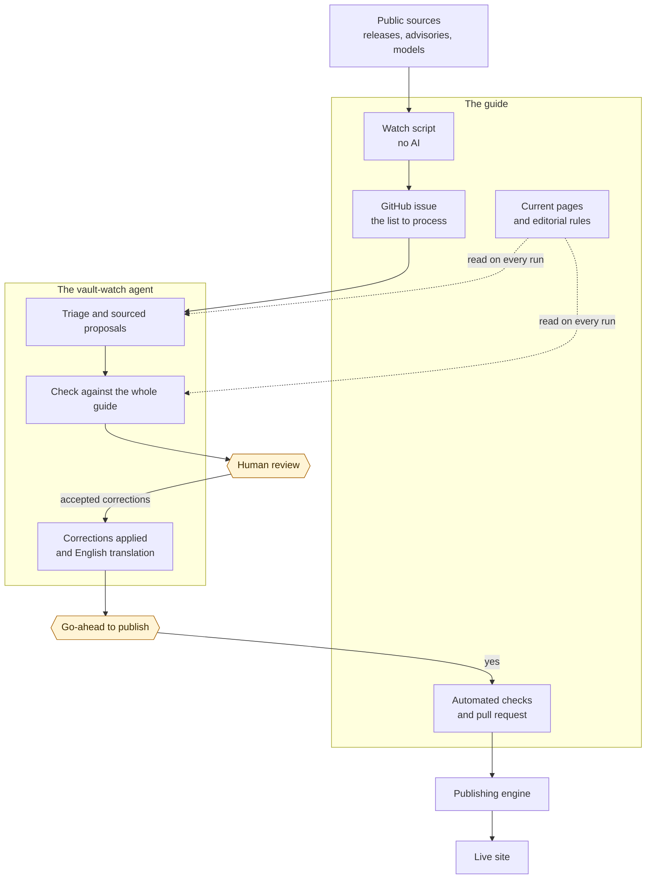

> [!tip] In short
> AI tools change every week, and a technical guide goes stale quickly. Here, a program spots what has changed, an AI proposes corrections with their sources, and a person decides what gets published. Nothing reaches the site without that approval.

This guide is written and kept up to date by AI agents, every change is approved by a human. This page explains who does what, and what the AI is not allowed to do.

## Three separate roles

| Who | What it does | What it does not do |
| :-- | :-- | :-- |
| **A script, no AI** | Records new releases, security advisories, new models and vendor news, then drops what does not matter using fixed rules | It does not judge whether a page is wrong |
| **An AI agent** ([[projet/vault-watch-agent\|vault-watch-agent]]) | Finds the passages that have become wrong, proposes new text and its source, checks its proposals against the whole guide, translates the changes into English | It changes no file itself and publishes nothing |
| **A human**, the author | Starts the agent, reviews each proposal, authorizes publication | They do not copy the watch by hand |

An ordinary program then applies the accepted corrections. It refuses any correction whose quoted text does not occur exactly once in the page, so the AI cannot rewrite a passage it misread. This is the [[00-lexique/human-in-the-loop|human-in-the-loop]] principle.

## How the projects fit together

Two projects work together: [[projet/guide|the guide]] holds the pages, the editorial rules and the watch script, and [[projet/vault-watch-agent|the agent]] does the analysis. A third one, [[projet/starlight-obsidian-engine|the publishing engine]], turns the pages into a website.

The editorial rules stay in the guide and the agent loads them on every run: it keeps no copy that could drift.

## Timeline of an update

1. **On Monday morning, every other week, the script collects** the changes of the last 15 days. It runs on its own on GitHub. In the other weeks, it only steps in if a serious vulnerability is not covered by the guide.
2. **It opens a public GitHub issue** listing the items to examine, and the author is notified by email.
3. **The author starts the agent by hand.** This is a choice, to keep an eye on the budget: the interface shows an estimate of the run's cost before it starts. This step could be automated if needed, without removing the two human approvals that follow.
4. **The agent sorts the items**: to correct, possibly to add, or of no interest to the guide.
5. **It proposes corrections.** Each one quotes the current text word for word, and gives the new text and a source.
6. **It reviews itself.** Another pass compares each correction with the whole French guide and with sources on the web, then keeps, revises or rejects it.
7. **First pause: the review.** The author accepts everything, nothing, or a selection. The agent can wait for days without losing anything.
8. **The accepted corrections are applied** on a separate branch, and the English pages are updated.
9. **The checks run**: metadata, diagrams, translations, external links of the changed pages.
10. **Second pause: the go-ahead to publish.** Nothing leaves the author's machine before this green light.
11. **The pull request passes GitHub's checks**, then the author merges it.
12. **The site updates automatically** after the merge.

> [!example] A real case
> The [watch of 2 November 2026](https://github.com/DamienBecherini/ia-on-prem-vault/issues/50) listed 81 items, including 8 security advisories. After review, the corrections were merged on 8 November in [pull request 51](https://github.com/DamienBecherini/ia-on-prem-vault/pull/51), which changes 12 files in French and English.

Reported errors follow the same path: they are checked against primary sources, then go through the same review and the same pull request.

## A cloud AI for a guide on self-hosting?

Yes, and it is better to say so. The agent calls Claude models through the Anthropic API, a cloud service. It only processes the content of this guide, which is meant to be public, and no confidential data, so the question of [[05-agents-et-assistants-on-prem/fondations-communes/sovereignty-and-privacy|sovereignty]] does not arise as it would for medical or legal files. This choice is not advice for your sensitive data, which this guide helps you keep on your own premises.

## What the upkeep costs

Cost of the Claude API calls at list price, [measured in November 2026](https://github.com/DamienBecherini/vault-watch-agent#what-the-upkeep-costs), with Claude Opus 5.5 for the triage (medium effort), the proposals and the cross-check (high effort), and Claude Sonnet 5.5 for the translation (medium effort). Another model or effort level would give other figures:

| Run | Cost |
| :-- | --: |
| Watch with simple page excerpts | $0.90 |
| Full watch, checked against the whole guide | $3.80 to $4.40 |
| Fixing reported errors, 26 corrections | $6.60 |

The [public journal](https://github.com/DamienBecherini/vault-watch-agent/blob/main/metrics/usage.jsonl) lists each call, with its model and cost.

## The limits

- **Errors remain possible.** Check the cited sources before relying on a figure, and [report an error](https://github.com/DamienBecherini/ia-on-prem-vault/issues) if you find one.
- **Dates are hard.** A software release has a creation date, a tag date and a publication date. When its sources do not settle a date, the agent declines.
- **The agent corrects, it does not write new pages.** A new tool or model is a lead for it; deciding to add it remains an editorial choice.
