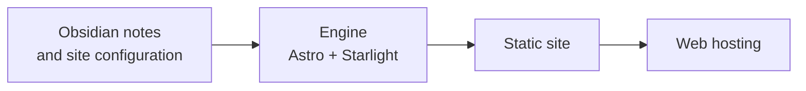

> [!tip] In short
> starlight-obsidian-engine is the tool that builds this site from plain notes. The author writes in the Obsidian application, and the engine turns that into fast web pages, in several languages. It is free and reusable for your own notes.

## What it is for

The engine separates content from presentation. The notes stay in their own repository, the site code in another: you can write without touching the code, and publish several sites with the same engine.



## What it gives the reader

- **Definitions on hover.** Hover over the word [[00-lexique/vram|VRAM]]: its definition appears without leaving the page.
- **Interactive diagrams.** Mermaid diagrams can be zoomed, panned and opened full screen.
- **Incoming references.** Each page lists those that cite it.
- **Reading prerequisites.** A box shows what to read first.
- **French and English.** The internal links of a translated page lead to the translated version when it exists.
- **Visible freshness.** The bottom of the page shows the change and verification dates.

## What it gives the author

- **The Obsidian way of writing, kept**: `[[...]]` links, templates, callouts, formulas and Mermaid diagrams.
- **Configuration on the content side.** The title, address, languages and menu are set in the vault's `site.config.json` file.
- **Private notes protected.** The `_private/` folder and excluded files are never published.
- **Incremental publishing.** Only changed files are sent to the server, over FTPS or SFTP.
- **Checks.** An audit reports broken internal links.

## Try it

You need Node.js 22 or later. From a folder next to your Obsidian vault:

```bash
git clone https://github.com/DamienBecherini/starlight-obsidian-engine.git
cd starlight-obsidian-engine
cp .env.example .env    # set VAULT_PATH=../your-vault
npm install
npm run dev
```

The [project README](https://github.com/DamienBecherini/starlight-obsidian-engine#site-configuration-siteconfigjson-in-the-vault) describes the configuration and deployment.

## Its limits

- **Password protection** of the site only works on Apache hosting.
- **It expects an organized vault** with metadata at the top of each note.

**GitHub repository:** [DamienBecherini/starlight-obsidian-engine](https://github.com/DamienBecherini/starlight-obsidian-engine), under the 0BSD licence, reusable without conditions.
