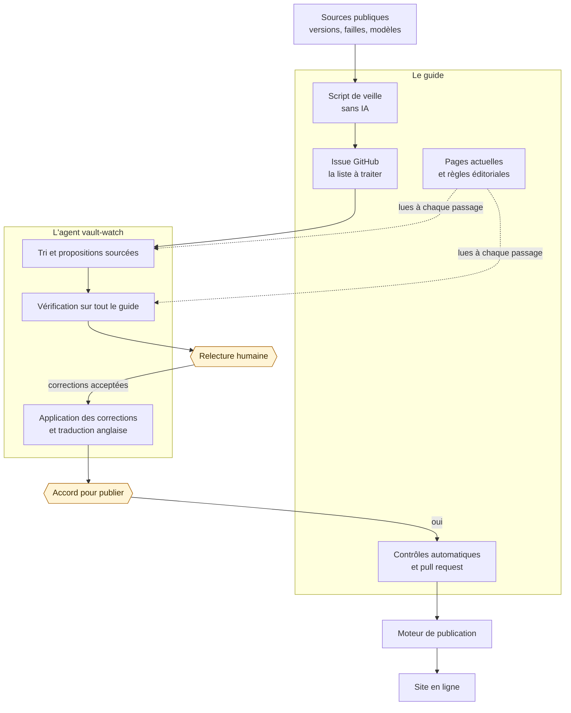

> [!tip] En bref
> Les outils d'IA changent chaque semaine, et un guide technique périme vite. Ici, un programme repère ce qui a changé, une IA propose des corrections avec leurs sources, et une personne décide de ce qui est publié. Rien n'arrive sur le site sans cette validation.

Ce guide est écrit avec l'aide d'agents IA ; son auteur relit et valide chaque modification avant publication. Cette page explique qui fait quoi, et ce que l'IA n'a pas le droit de faire.

## Trois rôles bien séparés

| Qui | Ce qu'il fait | Ce qu'il ne fait pas |
| :-- | :-- | :-- |
| **Un script, sans IA** | Relève les nouvelles versions, les failles de sécurité, les nouveaux modèles et l'actualité des fabricants, puis écarte ce qui ne compte pas selon des règles fixes | Il ne juge pas si une page est fausse |
| **Un agent IA** ([[projet/vault-watch-agent\|vault-watch-agent]]) | Repère les passages devenus faux, propose un nouveau texte et sa source, vérifie ses propositions sur l'ensemble du guide, traduit les changements en anglais | Il ne modifie aucun fichier lui-même et ne publie rien |
| **Un humain**, l'auteur | Lance l'agent, relit chaque proposition, autorise la publication | Il ne recopie pas la veille à la main |

Un programme ordinaire applique ensuite les corrections acceptées. Il refuse toute correction dont le texte cité ne se trouve pas exactement une fois dans la page : l'IA ne peut donc pas réécrire un passage qu'elle aurait mal lu. C'est le principe du [[00-lexique/human-in-the-loop|human-in-the-loop]], l'humain dans la boucle.

## Comment les projets s'articulent

Deux projets travaillent ensemble : [[projet/guide|le guide]] contient les pages, les règles éditoriales et le script de veille, et [[projet/vault-watch-agent|l'agent]] fait le travail d'analyse. Un troisième, [[projet/starlight-obsidian-engine|le moteur de publication]], transforme les pages en site web.

Les règles éditoriales restent dans le guide et l'agent les charge à chaque passage : il n'en garde pas de copie qui pourrait diverger.

## Chronologie d'une mise à jour

1. **Le lundi matin, une semaine sur deux, le script collecte** les changements des 15 derniers jours. Il tourne tout seul sur GitHub. Les autres semaines, il n'intervient que si une faille grave n'est pas couverte par le guide.
2. **Il ouvre une issue GitHub publique** qui liste les éléments à examiner, et l'auteur en est averti par e-mail.
3. **L'auteur lance l'agent à la main.** C'est un choix, pour surveiller le budget : l'interface affiche une estimation du coût de la passe avant son lancement. Ce démarrage pourrait être automatisé si besoin, sans supprimer les deux validations humaines qui suivent.
4. **L'agent trie les éléments** : à corriger, à ajouter peut-être, ou sans intérêt pour le guide.
5. **Il propose des corrections.** Chacune cite le texte actuel mot pour mot, donne le nouveau texte et une source.
6. **Il se relit.** Une nouvelle passe compare chaque correction à l'ensemble du guide français et aux sources sur le web, puis la garde, la révise ou la rejette.
7. **Première pause : la relecture.** L'auteur accepte tout, rien, ou une sélection. L'agent peut attendre plusieurs jours sans rien perdre.
8. **Les corrections acceptées sont appliquées** sur une branche séparée, et les pages anglaises sont mises à jour.
9. **Les contrôles s'exécutent** : métadonnées, schémas, traductions, liens externes des pages modifiées.
10. **Deuxième pause : l'accord pour publier.** Rien ne quitte la machine de l'auteur avant ce feu vert.
11. **La pull request passe les contrôles de GitHub**, puis l'auteur la fusionne.
12. **Le site se met à jour automatiquement** après la fusion.

> [!example] Un cas réel
> La [veille du 2 novembre 2026](https://github.com/DamienBecherini/ia-on-prem-vault/issues/50) listait 81 éléments, dont 8 failles de sécurité. Après relecture, les corrections ont été fusionnées le 8 novembre dans la [pull request n° 51](https://github.com/DamienBecherini/ia-on-prem-vault/pull/51), qui modifie 12 fichiers en français et en anglais.

Les erreurs signalées suivent le même chemin : elles sont vérifiées sur des sources primaires, puis passent par la même relecture et la même pull request.

## Une IA dans le cloud pour un guide sur l'auto-hébergement ?

Oui, et il vaut mieux le dire. L'agent appelle les modèles Claude par l'API d'Anthropic, un service cloud. Il ne traite que le contenu de ce guide, destiné à être public, et aucune donnée confidentielle : la question de la [[05-agents-et-assistants-on-prem/fondations-communes/sovereignty-and-privacy|souveraineté]] ne se pose donc pas comme pour des dossiers médicaux ou juridiques. Ce choix n'est pas un conseil pour vos données sensibles, que ce guide vous aide justement à garder chez vous.

## Ce que coûte l'entretien

Coût des appels à l'API Claude au tarif public, [mesuré en novembre 2026](https://github.com/DamienBecherini/vault-watch-agent#what-the-upkeep-costs), avec Claude Opus 5.5 pour le tri (effort moyen), les propositions et la vérification (effort élevé), et Claude Sonnet 5.5 pour la traduction (effort moyen). Un autre modèle ou un autre niveau d'effort donnerait d'autres chiffres :

| Passage | Coût |
| :-- | --: |
| Veille avec de simples extraits des pages | 0,90 $ |
| Veille complète, avec vérification sur tout le guide | 3,80 à 4,40 $ |
| Correction d'erreurs relevées, 26 corrections | 6,60 $ |

Le [journal public](https://github.com/DamienBecherini/vault-watch-agent/blob/main/metrics/usage.jsonl) détaille chaque appel, avec son modèle et son coût.

## Les limites

- **Des erreurs restent possibles.** Vérifiez les sources citées avant de vous appuyer sur un chiffre, et [signalez une erreur](https://github.com/DamienBecherini/ia-on-prem-vault/issues) si vous en trouvez une.
- **Les dates sont difficiles.** Une version logicielle a une date de création, de marquage et de publication. Quand ses sources ne tranchent pas, l'agent s'abstient.
- **L'agent corrige, il n'écrit pas de nouvelles pages.** Un nouvel outil ou un nouveau modèle lui sert de piste ; décider de l'ajouter reste un choix éditorial.
