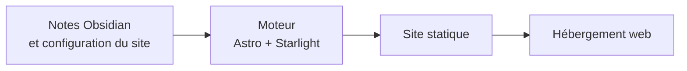

> [!tip] En bref
> starlight-obsidian-engine est l'outil qui fabrique ce site à partir de simples notes. L'auteur écrit dans l'application Obsidian, et le moteur en fait des pages web rapides, en plusieurs langues. Il est gratuit et réutilisable pour vos propres notes.

## À quoi il sert

Le moteur sépare le contenu de sa présentation. Les notes restent dans leur propre dépôt, le code du site dans un autre : on peut écrire sans toucher au code, et publier plusieurs sites avec le même moteur.



## Ce qu'il apporte au lecteur

- **Des définitions au survol.** Un lien vers le lexique affiche sa définition sans quitter la page.
- **Des schémas interactifs.** Les diagrammes Mermaid se zooment, se déplacent et s'ouvrent en plein écran.
- **Les références entrantes.** Chaque page liste celles qui la citent.
- **Les prérequis de lecture.** Un encadré indique quoi lire d'abord.
- **Le français et l'anglais.** Les liens internes d'une page traduite mènent à la version traduite lorsqu'elle existe.
- **La fraîcheur affichée.** Le bas de page indique les dates de modification et de vérification.

## Ce qu'il apporte à l'auteur

- **L'écriture Obsidian conservée** : liens `[[...]]`, modèles, encadrés, formules et schémas Mermaid.
- **Une configuration côté contenu.** Le titre, l'adresse, les langues et le menu se règlent dans le fichier `site.config.json` du coffre.
- **Les notes privées protégées.** Le dossier `_private/` et les fichiers exclus ne sont jamais publiés.
- **Une publication incrémentale.** Seuls les fichiers modifiés sont envoyés au serveur, par FTPS ou SFTP.
- **Des contrôles.** Un audit signale les liens internes cassés.

## L'essayer

Il faut Node.js 22 ou plus récent. Depuis un dossier voisin de votre coffre Obsidian :

```bash
git clone https://github.com/DamienBecherini/starlight-obsidian-engine.git
cd starlight-obsidian-engine
cp .env.example .env    # indiquer VAULT_PATH=../votre-coffre
npm install
npm run dev
```

Le [README du projet](https://github.com/DamienBecherini/starlight-obsidian-engine#site-configuration-siteconfigjson-in-the-vault) décrit la configuration et la mise en ligne.

## Ses limites

- **La protection par mot de passe** du site ne fonctionne que sur un hébergement Apache.
- **Il suppose un coffre organisé** avec des métadonnées en tête de chaque note.

**Dépôt GitHub :** [DamienBecherini/starlight-obsidian-engine](https://github.com/DamienBecherini/starlight-obsidian-engine), sous licence 0BSD, réutilisable sans condition.
